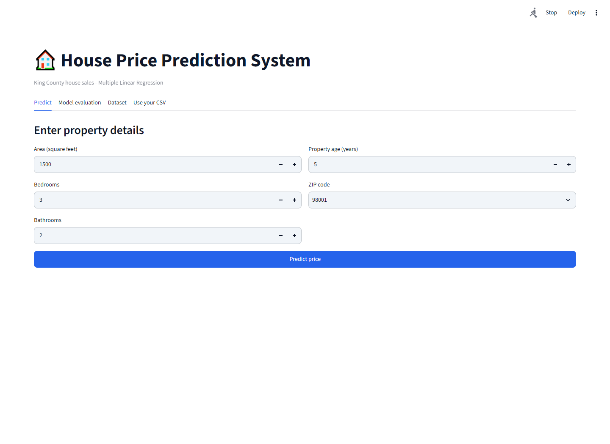

# House Price Prediction System

[](https://www.python.org/)
[](https://streamlit.io/)
[](https://scikit-learn.org/)
[](tests/)
[](LICENSE)
[](https://github.com/kamrullab/house-price-prediction-system)
[](https://colab.research.google.com/github/kamrullab/house-price-prediction-system/blob/main/notebooks/House_Price_Prediction_Colab.ipynb)
[](https://colab.research.google.com/github/kamrullab/house-price-prediction-system/blob/main/notebooks/Dhaka_House_Rent_Prediction_BDT_Colab.ipynb)
[](https://github.com/kamrullab/house-price-prediction-system/actions)

## 🚀 Choose your one-click Google Colab

| Project | Currency and target | One-click notebook |
|---|---|---|
| 🏠 House sale-price model | 🇺🇸 Historical sale price in **USD ($)** | [](https://colab.research.google.com/github/kamrullab/house-price-prediction-system/blob/main/notebooks/House_Price_Prediction_Colab.ipynb) |
| 🇧🇩 Dhaka rent model | 💰 Monthly asking rent in **BDT (৳/month)** | [](https://colab.research.google.com/github/kamrullab/house-price-prediction-system/blob/main/notebooks/Dhaka_House_Rent_Prediction_BDT_Colab.ipynb) |

Click either colorful button, then select **Runtime > Run all**. Colab automatically installs packages, loads real data, creates charts, trains and compares models, evaluates results, and makes an example prediction. No upload, Google Drive mount, API key, or path editing is required.

> 🔵 **USD notebook:** King County historical house **sale prices**.<br>
> 🟢 **BDT notebook:** Dhaka **monthly asking rents** shown as `৳.../month`. These are two different prediction tasks; currency labels are never converted or mixed.

A complete academic machine-learning project that predicts residential property prices with Multiple Linear Regression. It includes real public house-sale data, preprocessing, model evaluation, automated tests, and an interactive Streamlit web application.

> The bundled CSV contains real King County, Washington house sales from May 2014 to May 2015. It is useful for education, but its age and location mean it must not be treated as a current valuation tool.



## 📦 Project deliverables

- [Google Colab notebook](notebooks/House_Price_Prediction_Colab.ipynb)
- [Dhaka BDT rent-prediction Colab notebook](notebooks/Dhaka_House_Rent_Prediction_BDT_Colab.ipynb)
- [Academic report in Word format](output/document/House_Price_Prediction_Academic_Report.docx)
- [Academic report in PDF format](output/pdf/House_Price_Prediction_Academic_Report.pdf)
- [Generated EDA and evaluation figures](reports/figures/)
- [Model comparison results](reports/model_comparison.csv)

## ✨ Features

- Predicts prices from area, bedrooms, bathrooms, property age, and location
- Handles missing numeric and categorical values
- Encodes previously unseen locations safely
- Reports MAE, RMSE, and R² on a reproducible 80/20 test split
- Displays actual-versus-predicted results
- Saves the complete preprocessing and model pipeline with Joblib
- Includes unit tests and an interactive Streamlit interface
- Supports CSV upload, custom-model download, and prediction-history export
- Compares Linear Regression with a Random Forest benchmark
- Includes a Google Colab notebook, EDA charts, residual analysis, and an academic report
- Includes a separate one-click Bangladesh notebook trained on real Dhaka rental listings with BDT/month output

## Project structure

```text
.
├── app.py                      # Streamlit web application
├── data/housing.csv            # Real King County house-sales dataset
├── download_real_data.py       # Downloads a fresh copy from OpenML
├── generate_sample_data.py     # Generates test/demo data if needed
├── analysis.py                 # Creates EDA and evaluation figures
├── notebooks/                  # Google Colab-compatible notebook
├── reports/                    # Metrics, figures, and academic report
├── src/model.py                # Validation, preprocessing, training, inference
├── tests/test_model.py         # Automated tests
├── train_model.py              # Command-line training entry point
├── requirements.txt            # Runtime dependencies
└── requirements-dev.txt        # Runtime and test dependencies
```

## Requirements

- Python 3.10 or newer
- Git (only needed for cloning)

## Setup on Windows PowerShell

Run each command separately. Every command has its own copy button on GitHub.

```powershell
git clone https://github.com/kamrullab/house-price-prediction-system.git
```

```powershell
cd house-price-prediction-system
```

```powershell
python -m venv .venv
```

```powershell
.\.venv\Scripts\Activate.ps1
```

```powershell
python -m pip install --upgrade pip
```

```powershell
pip install -r requirements.txt
```

```powershell
python train_model.py
```

```powershell
python -m streamlit run app.py
```

Open the local address printed by Streamlit, normally <http://localhost:8501>.

If PowerShell prevents activation, run this once in the current terminal and activate again:

```powershell
Set-ExecutionPolicy -Scope Process -ExecutionPolicy Bypass
```

## Setup on macOS or Linux

```bash
git clone https://github.com/kamrullab/house-price-prediction-system.git
```

```bash
cd house-price-prediction-system
```

```bash
python3 -m venv .venv
```

```bash
source .venv/bin/activate
```

```bash
python -m pip install --upgrade pip
```

```bash
pip install -r requirements.txt
```

```bash
python train_model.py
```

```bash
python -m streamlit run app.py
```

Run each command separately. Every command has its own copy button on GitHub.

## 🌍 Real datasets

The committed `data/housing.csv` is prepared from the **King County House Sales** dataset on [OpenML](https://www.openml.org/search?id=42092&type=data). The source contains 21,613 sales, 19 property features plus price and ID, and is released under **CC0 Public Domain**. Cleaning leaves 21,601 usable rows in this repository.

The app uses these fields:

| App field | Original field | Meaning |
|---|---|---|
| `area` | `sqft_living` | Interior living area in square feet |
| `bedrooms` | `bedrooms` | Bedroom count |
| `bathrooms` | `bathrooms` | Bathroom count |
| `age` | `date - yr_built` | Age when the property was sold |
| `location` | `zipcode` | Property ZIP code |
| `price` | `price` | Recorded sale price in USD |

The repository already contains the prepared CSV, so setup works without downloading anything else. To refresh it directly through Scikit-learn's documented [`fetch_openml`](https://scikit-learn.org/stable/modules/generated/sklearn.datasets.fetch_openml.html) interface, run:

```bash
python download_real_data.py
```

### 🇧🇩 Bangladesh dataset for the BDT Colab

The BDT notebook downloads **3,083 real Dhaka residential rental listings** directly from [Mendeley Data (DOI 10.17632/d3rxcxn74y.1)](https://doi.org/10.17632/d3rxcxn74y.1). It includes monthly asking rent in BDT, neighbourhood, floor size, bedrooms, bathrooms, property type, furnishing, condition, listing details, and amenity indicators. The dataset is released under **CC0 1.0**.

The notebook fetches the CSV automatically, so it works without a local Bangladesh dataset file. Its output is monthly asking rent such as `৳45,000/month`—not a property sale price.

## ▶️ Google Colab

Use either Colab badge at the top of this README. In Colab, choose **Runtime > Run all**. Both notebooks are self-contained and need no secrets or manual file setup.

## Generate the complete analysis

```bash
python analysis.py
```

This writes the correlation heatmap, area-price chart, actual-predicted chart, residual plots, Linear Regression metrics, and model-comparison table to `reports/`.

## Deploy on Streamlit Community Cloud

1. Sign in at [share.streamlit.io](https://share.streamlit.io/) with GitHub.
2. Select **Create app** and choose `kamrullab/house-price-prediction-system`.
3. Select branch `main` and entry point `app.py`.
4. Select **Deploy**. No secrets or environment variables are required.

The included `.streamlit/config.toml` provides the production theme and headless server configuration.

## Train with your own data

Create a CSV containing these exact columns:

| Column | Type | Example | Meaning |
|---|---:|---:|---|
| `area` | number | `1500` | Floor area in square feet |
| `bedrooms` | integer | `3` | Bedroom count |
| `bathrooms` | integer | `2` | Bathroom count |
| `age` | number | `5` | Property age in years |
| `location` | text | `98178` | Area, neighborhood, or ZIP code |
| `price` | number | `450000` | Target price in the dataset's currency |

Then train the model:

```bash
python train_model.py --data path/to/your-housing-data.csv --output models/house_price_model.joblib
```

The app reads its location choices directly from the CSV.

## Run tests

```bash
pip install -r requirements-dev.txt
pytest -q
```

## Methodology

1. Validate required columns and remove duplicate records.
2. Drop records without a target price.
3. Impute missing numeric values with the median.
4. Impute missing locations with the most frequent value and one-hot encode them.
5. Split records into 80% training and 20% testing data with a fixed random seed.
6. Fit a Multiple Linear Regression model.
7. Evaluate predictions with MAE, RMSE, R², and an actual-versus-predicted chart.

The model follows the general form:

```text
price = intercept + b1(area) + b2(bedrooms) + b3(bathrooms)
        + b4(age) + location effects + error
```

## Limitations

- The bundled sales are from 2014-2015 and are not current market valuations.
- Housing markets change over time, so production models require recent local data and periodic retraining.
- Linear regression may not capture complex nonlinear relationships.
- A prediction is an estimate, not a certified property valuation.

## License

Released under the [MIT License](LICENSE).

